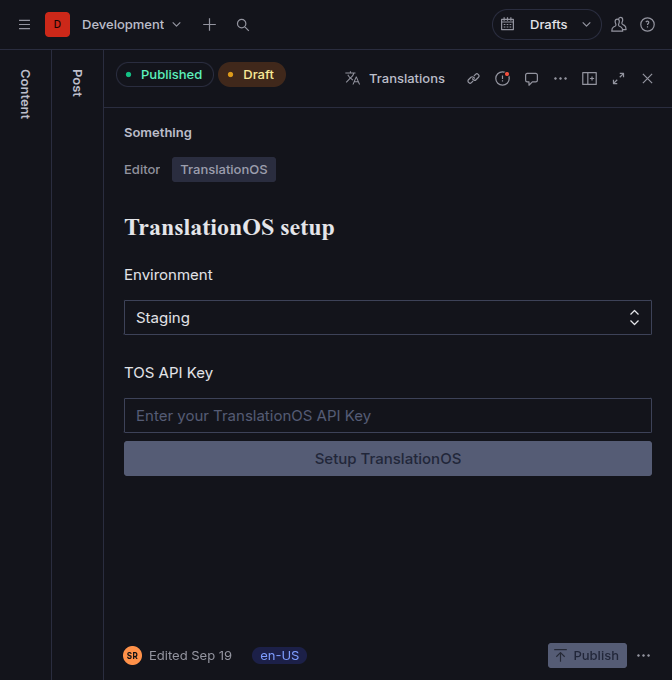
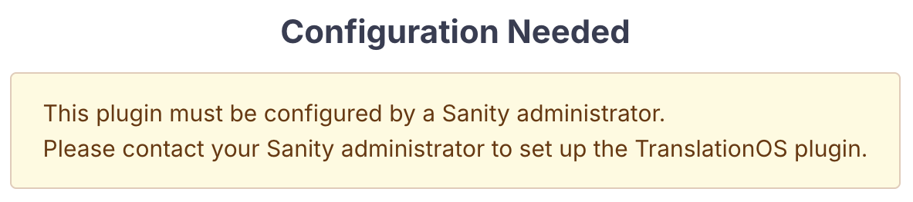
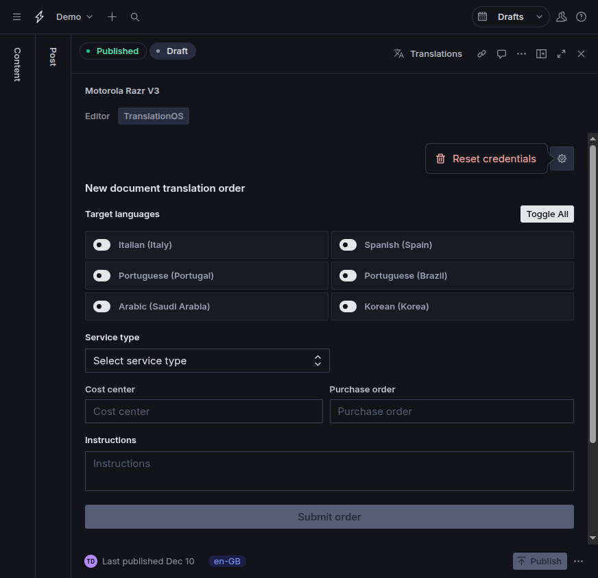

# TranslationOS plugin for Sanity Studio v3

A plugin for **Sanity Studio v3** that integrates with the TranslationOS API to translate Sanity documents.

This plugin requires either the [Sanity document internationalization plugin](https://www.sanity.io/plugins/document-internationalization) or the [Sanity field-level internationalization plugin](https://github.com/sanity-io/sanity-plugin-internationalized-array).

## Features

The TranslationOS plugin for Sanity offers two independent translation modes:

- **Single document translation**: Sends a single document to the TranslationOS API for translation. Supports both document-level and field-level localization.
- **Bulk document translation**: Sends multiple documents to the TranslationOS API for translation. Supports **document-level** localization only.

Single document translation is available within the [Structure tool](https://www.sanity.io/docs/studio/structure-tool).
Bulk document translation is available as a top-level tool.

## Installation

Add the plugin to your Sanity Studio project as a dependency by running:

```sh
npm install sanity-plugin-tos
```

## Configuration

Add the plugin to your `sanity.config.ts` (or `.js`).

Below is an example configuration using both modes, sharing languages and document types with the internationalization plugins, and defining supported field types.

We recommended using [TranslationOS-supported language codes](https://api.translated.com/v2/symbol/languages), but we can unofficially support other language codes by configuring a custom mapping.

```typescript
import {defineConfig} from 'sanity'
import {StructureBuilder} from "sanity/structure";
import {tosPlugin} from 'sanity-plugin-tos'
import {internationalizedArray} from 'sanity-plugin-internationalized-array'

// Languages shared across plugins
const languages = [
    {id: 'en-US', title: 'English (US)'},
    {id: 'fr-FR', title: 'French (France)'},
    {id: 'de-DE', title: 'German (Germany)'},
    {id: 'es-ES', title: 'Spanish (Spain)'},
];

// Document types handled by each mode
const documentLevelTypes = ['post', 'author']
const fieldLevelTypes = ['blog']

// Common TranslationOS configuration
const tosCommonConfig = {
    supportedLanguages: languages,
    customBlockTypes: ['myblock'],
}

export default defineConfig({
    // [...]
    plugins: [
        // [...]
        documentInternationalization({
            supportedLanguages: languages,
            schemaTypes: documentLevelTypes,
            weakReferences: true,
        }),
        structureTool({
            defaultDocumentNode: (S: StructureBuilder, {schemaType}: DefaultDocumentNodeContext) => {
                if ([...documentLevelTypes, ...fieldLevelTypes].includes(schemaType)) {
                    return S.document().views([
                        S.view.form(),
                        // Structure tool plugin view for single document translation
                        tosPlugin(S, {
                            ...tosCommonConfig,
                            // Document types supported in document-level translation mode
                            documentLocalizationSchemaTypes: documentLevelTypes,
                            // Document types supported in field-level translation mode
                            fieldLocalizationSchemaTypes: fieldLevelTypes,
                        })
                    ])
                }
            }
        }),
        internationalizedArray({
            languages,
            fieldTypes: ['string', 'text', 'block'],
        }),
    ],

    // Top-level tool for bulk document translation in document-level translation mode
    tools: [
        translationOS({
            ...tosCommonConfig,
            schemaTypes: documentLevelTypes,
        })
    ],
})
```

## Plugin options

### `tosPlugin` (single document translation view)

Returns a `ComponentViewBuilder` to be added to the _editor views_ for specific document types.

**Recommended**: only enable for schema types configured in your internationalization plugin.

Options:

- `supportedLanguages` – array of `{id, title}` language objects
- `documentLocalizationSchemaTypes` – document types for document-level translation
- `fieldLocalizationSchemaTypes` – document types for field-level translation
- `customBlockTypes` – additional block type names to treat like Sanity's `block`

> **Note:** A schema type can't be included in both the `documentLocalizationSchemaTypes` and the `fieldLocalizationSchemaTypes` options,
otherwise the plugin will display a configuration error and won't work properly.

### `translationOS` (bulk document translation tool)

Returns a tool to be added to the top-level _tools_ array in your Sanity configuration.

**Recommended**: only enable for schema types configured in the document internationalization plugin.

Options:

- `supportedLanguages` – array of `{id, title}` language objects
- `customBlockTypes` – additional block type names to treat like Sanity's `block`
- `schemaTypes` – document types to manage with bulk translation

## Authentication

### Initial setup

The plugin requires a _TranslationOS API key_ to function. This API key will be stored securely in your Sanity dataset.
When you first use the plugin, by clicking on the _TranslationOS_ editor tab, you will be prompted to enter your API key and select the environment (`sandbox` or `production`).

**NOTE:** the authentication setup can be performed only by a Studio user with **admin privileges**.



Non-admin users will see a warning message requesting them to contact their Sanity administrator.



### Reset

If you need to change your API key or environment, you can reset the plugin configuration by clicking on the _Reset credentials_ menu item in the settings menu. The settings menu is accessible by clicking on the _cog_ button near the version badge in the top-right corner of the _TranslationOS_ editor tab.

**NOTE:** after resetting the authentication configuration, the plugin will display the setup screen again **for admin users** and the warning message for non-admin users.



## Known limitations

For field translation mode:

- Supports common types: `string`, `text`, `block`
- Supports nested `object` fields
- Does **not** traverse `array` fields to locate nested translatable fields

For rich text (block content):

- **Inline objects** (objects placed inside a line of text, among the spans of a block) are not supported: they are not sent for translation and are removed from the translated content.
- Every text field of an [object inside rich text](#objects-inside-rich-text) is translated, including values such as code or option values (e.g. `tone: "warning"`). Exclude them with [`tosProperties.exclude`](#field-level-options-in-schema).

### Unsupported fields

Fields whose content cannot be translated safely are **skipped** and keep their source-language content in the translated document. Before sending, the plugin lists them with their path and the reason:

- in the single document view, in a warning below the **Submit order** button;
- in the bulk tool, in a warning shown on the first click on **Place order**: click again to send the order without those fields.

Examples:

| Message | Reason |
| --- | --- |
| `body.2 (codeSnippet without _key)` | An object inside rich text has no `_key`, so it can't be restored after translation. The whole `body` field is skipped |
| `body.3 (object without _type)` | An item inside rich text has no `_type`. The whole `body` field is skipped |
| `ratings (array of number)` | Arrays of numbers (or of other non-text values) are not translatable |
| `gallery (mixed array)` | Arrays mixing texts, objects and other values are not translatable |

In the bulk tool each entry is prefixed with the document ID, e.g. `article-1: body.2 (codeSnippet without _key)`.

### Field-level options in schema

You can add `tosProperties` to any field to control translation behavior.

```typescript
defineField({
  name: 'fullname',
  type: 'string',
  title: 'Full Name',
  options: {
    tosProperties: {
      exclude: true, // exclude from translation
    }
  }
})
```

Adding `tosProperties.exclude: true` to an `object` field excludes all nested fields.

`tosProperties.exclude` works on the fields of [objects inside rich text](#objects-inside-rich-text) too: excluded fields are not sent and keep their original value in the translated document.

### Default behavior in document-level mode

By default, the plugin translates:

- All fields of type `string`, `text`, `slug`, `block`
- Nested fields within `array` or `object` values (recursively)
- Text fields of any object inside rich text (images, code snippets, embeds, ...), see [Objects inside rich text](#objects-inside-rich-text)
- Excludes Sanity metadata (`_id`, `_rev`, `_type`, `createdAt`, etc.)
- Excludes numbers, URLs, references, image assets and fields of type `number`, `datetime`, `reference` and `image`
- Excludes fields with `tosProperties.exclude: true`

### Rich text (block content) support

Sanity's `block` type represents rich text as an array of [objects](https://www.sanity.io/docs/block-type). The plugin converts these to HTML before sending to TranslationOS, preserving structure and context. Supported features include:

- Bold, italic, underline, strikethrough, code spans
- Headings, blockquotes
- Bullet and numbered lists
- Images and any other object inside the rich text, with their text fields translated (see [Objects inside rich text](#objects-inside-rich-text))
- Links with metadata (metadata preserved, not translated)

### Objects inside rich text

Rich text fields can contain any kind of object between their blocks: images, code snippets, video embeds, callouts, tables, custom objects, ...

For each of these objects:

- the object is kept **exactly as in the source document**: type, asset, crop and hotspot of images, references, numbers, booleans, URLs and any other field;
- only its **text fields** are translated, including those of nested objects and arrays and nested rich text (e.g. the content of a callout, with its own objects).

The following values are not translated: fields starting with `_`, references, numbers and numeric strings, URLs, empty strings.

Example: with the following schema, `alt` and `caption` of images and `title` and `content` of callouts are translated, while the image itself and the callout `tone` are kept as they are.

```typescript
export default defineType({
  name: 'blockContent',
  title: 'Block Content',
  type: 'array',
  of: [
    defineArrayMember({type: 'block'}),
    defineArrayMember({
      type: 'image',
      options: {hotspot: true},
      fields: [
        {name: 'alt', title: 'Alternative text', type: 'string'},
        {name: 'caption', title: 'Caption', type: 'string'},
      ],
    }),
    defineArrayMember({
      name: 'callout',
      title: 'Callout',
      type: 'object',
      fields: [
        {
          name: 'tone',
          title: 'Tone',
          type: 'string',
          options: {
            list: ['info', 'warning'],
            tosProperties: {exclude: true}, // <--- option value, must not be translated
          },
        },
        {name: 'title', title: 'Title', type: 'string'},
        {name: 'content', title: 'Content', type: 'array', of: [{type: 'block'}, {type: 'image'}]},
      ],
    }),
    defineArrayMember({
      name: 'codeSnippet',
      title: 'Code snippet',
      type: 'object',
      fields: [
        {name: 'code', title: 'Code', type: 'text', options: {tosProperties: {exclude: true}}}, // <--- code, must not be translated
        {name: 'description', title: 'Description', type: 'string'},
      ],
    }),
  ],
})
```

> **Note:** Every text field of these objects is translated unless excluded: remember to add `tosProperties.exclude: true` to fields such as code, identifiers or option values.

Objects are matched with the source document by their `_key`, which Sanity always adds to array items. Items without a `_key` (e.g. imported with a script) can't be restored, so the whole field is skipped and reported as [unsupported](#unsupported-fields).

### Custom block types

If you define custom block names in your schema, list them in `customBlockTypes` so the plugin can process them correctly.

Let's say you have the following rich text type definition:

```typescript
export default defineType({
  name: 'myrichtext',
  title: 'My Rich Text Content',
  type: 'array',
  of: [
    defineArrayMember({
      name: 'myblock', // <--- custom block type name
      title: 'My Block',
      type: 'block',
      styles: [
        {title: 'Normal', value: 'normal'},
        {title: 'H1', value: 'h1'},
      ],
      marks: {
        decorators: [
          {title: 'Code', value: 'code'}
        ],
      },
    }),
  ],
})
```

Fields of type `myrichtext` would have the following JSON structure:

```json5
{
  "_createdAt": "2025-01-16T13:48:35Z",
  "_id": "drafts.cc28b1ec-8340-41ae-a820-3cd3e4f6038c",
  "_rev": "b464c3da-548a-4402-a2a0-be29fb61120e",
  "_type": "post",
  "_updatedAt": "2025-01-17T13:44:05Z",
  "body": [
    {
      "_key": "aba42a503204",
      "_type": "myblock", // <--- custom block type name
      "children": [
        {
          "_key": "e8799f8c0f9e",
          "_type": "span",
          "marks": [],
          "text": "The Post Body"
        }
      ],
      "markDefs": [],
      "style": "h2"
    }
  ]
}
```

You must configure the plugin to correctly handle fields of type `myrichtext` with `myblock` elements as follows:

```typescript
tosPlugin(S, {
  // [...]
  customBlockTypes: ['myblock'],
})
```

### Link handling

The plugin supports links with arbitrary metadata inside rich text. Metadata is preserved but not translated.

Example:

```typescript
export default defineType({
  name: 'blockContent',
  title: 'Block Content',
  type: 'array',
  of: [
    defineArrayMember({
      title: 'Block',
      type: 'block',
      // [...]
      marks: {
        decorators: [
          // [...]
        ],
        annotations: [
          {
            name: 'link',
            title: 'Complex Link',
            type: 'object',
            fields: [
              {
                name: 'title',
                title: 'Title',
                type: 'string',
              },
              {
                name: 'external',
                title: 'External Link',
                type: 'url',
              },
              {
                name: 'author',
                title: 'Author',
                type: 'reference',
                to: [{type: 'author'}]
              },
              {
                name: 'newTab',
                title: 'Open in new tab',
                type: 'boolean',
                initialValue: false,
                description: 'Set to true to open the link in a new tab.',
              },
            ],
          },
        ],
      },
    }),
  ],
})
```

## Migration from older versions to version 5.x

If you are migrating from version 4.x or below to version 5.x of the `sanity-plugin-tos`, please note the following.
In version 5.x, the plugin changes how it manages the TOS API key. Once you update to v5, the process mentioned in the
**Authentication** section above will have to be followed.
The plugin also requires you to slightly change your previous configuration.
Please follow the steps below:

- Remove the `apiKey` and `env` options from your TOS plugin configuration in `sanity.config.ts` or `sanity.config.js`, both from the `tosPlugin` or the `translationOS` tool.
- Start your Sanity Studio, the TOS configuration page should pop up automatically.
- Fill in the required fields (TOS API key, environment) and save the configuration.

The authentication information will be saved in your Sanity Studio dataset as a document of type `translationOSSettings`, and the
plugin will use this configuration from then on.
